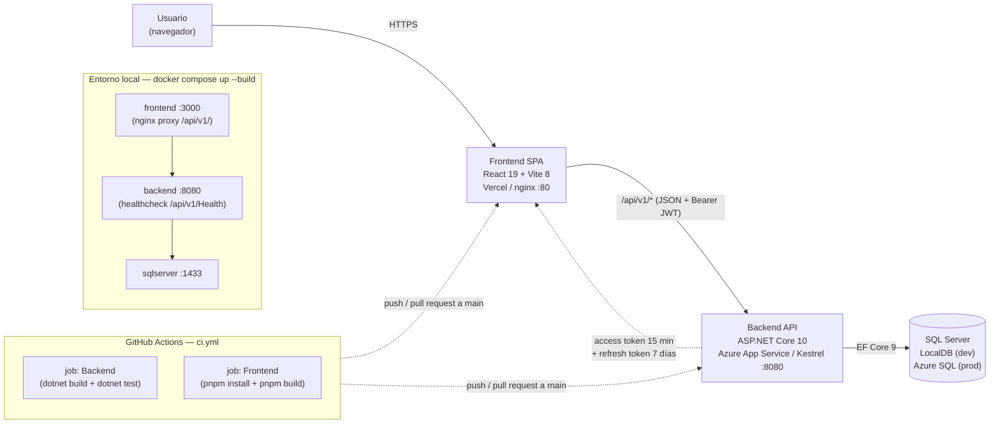
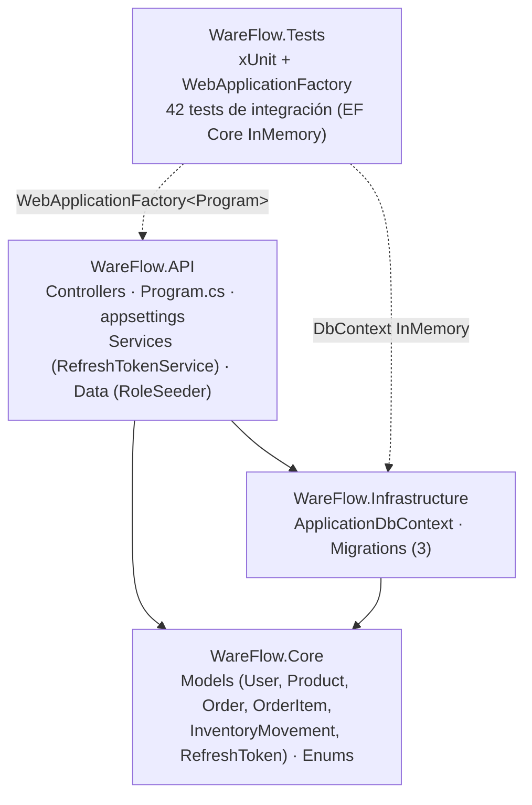
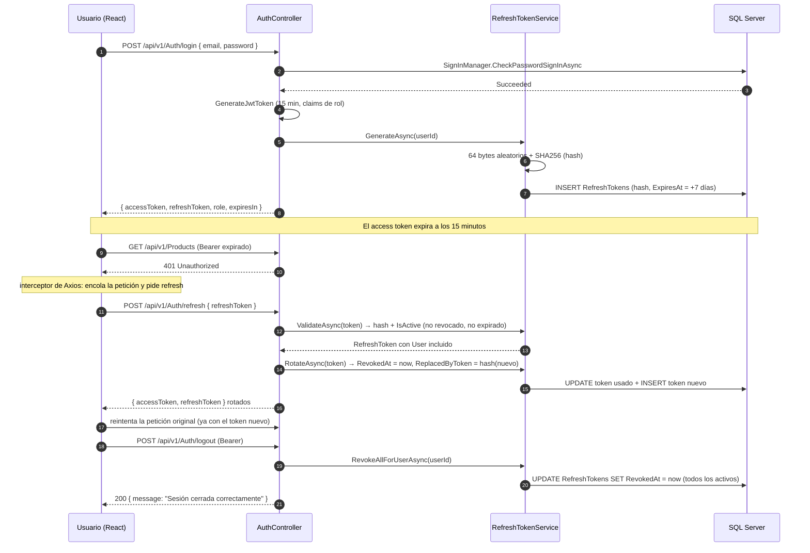
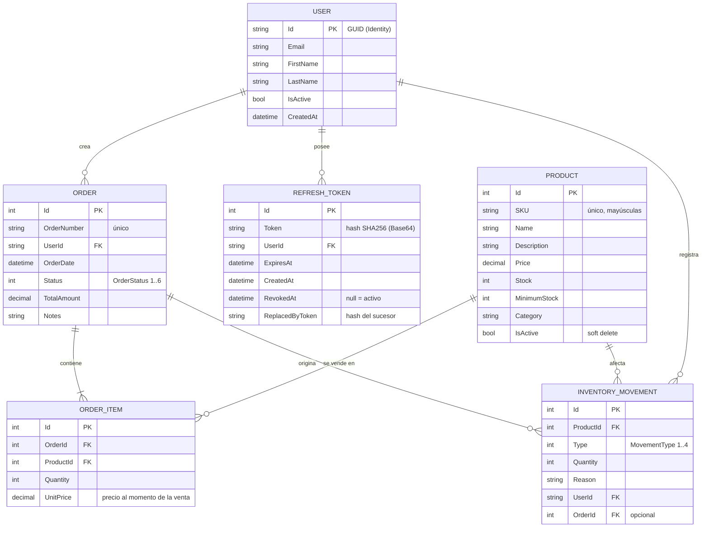

# Arquitectura — WareFlow

Documentación técnica de la arquitectura de WareFlow: visión general del sistema,
capas del backend, flujo de autenticación y modelo de datos.

**Índice**

- [Visión general](#visión-general)
- [Capas del backend](#capas-del-backend)
- [Flujo de autenticación](#flujo-de-autenticación)
- [Modelo de datos](#modelo-de-datos)

---

## Visión general

- El frontend consume **un solo origen** de datos: la API REST versionada en `/api/v1/`.
- En Docker, nginx sirve la SPA y hace de proxy inverso de `/api/v1/` hacia `backend:8080`,
  por lo que no hay CORS entre contenedores (`VITE_API_URL=/api/v1`).
- En despliegue, el frontend (Vercel) y la API (Azure App Service) son orígenes
  distintos: CORS se configura con `Cors:AllowedOrigins` (ver `appsettings.Production.json`).
- La autorización viaja en el header `Authorization: Bearer <access token>` y se
  resuelve con los claims de rol incluidos en el JWT, sin consultar la base de datos.

---

## Capas del backend

Clean Architecture simplificada en 3 capas + proyecto de pruebas (ver
[ADR 001](adr/001-clean-architecture.md)). La flecha indica la dirección de la
referencia entre proyectos.

| Capa | Responsabilidad | No debe contener |
|------|-----------------|------------------|
| `WareFlow.API` | HTTP, autenticación, CORS, Swagger, arranque y migraciones | Reglas de negocio complejas |
| `WareFlow.Core` | Entidades, enums y DTOs del dominio | Referencias a EF Core, ASP.NET o Identity |
| `WareFlow.Infrastructure` | DbContext, mapeo fluent y migraciones | Lógica de negocio |

## Flujo de autenticación

JWT de vida corta + refresh token rotativo (ver [ADR 002](adr/002-jwt-refresh-tokens.md)):

Puntos clave:

- En la base de datos sólo se guarda el **hash SHA256** del refresh token; el valor
  en claro existe únicamente en la respuesta al cliente (login y refresh).
- Cada refresh **rota** el token: el usado se revoca y se enlaza al nuevo con
  `ReplacedByToken`, así que un token filtrado sirve una sola vez.
- `logout` revoca todos los tokens activos del usuario: es una revocación real en
  servidor, no sólo un borrado del token en `localStorage`.
- **Roles:** el primer usuario registrado en una base vacía recibe `Admin`; el resto
  entra como `Vendedor` (el `RoleSeeder` del arranque repara además a usuarios sin rol,
  asignando `Admin` al más antiguo y `Vendedor` al resto).

---

## Modelo de datos

Modelo de dominio (6 entidades, mapeadas a 5 tablas propias más `AspNetUsers`) y sus
relaciones. Las tablas de ASP.NET Core Identity (7) se listan en las notas finales.

Enums usados por el modelo:

| Enum | Valores |
|------|---------|
| `OrderStatus` | `Pending`, `Processing`, `Shipped`, `Delivered`, `Cancelled`, `Returned` |
| `MovementType` | `Purchase`, `Sale`, `Return`, `Adjustment` |

Notas de implementación:

- `Price`, `UnitPrice` y `TotalAmount` se mapean como `decimal(18,2)`
  (`HasPrecision(18, 2)` en `OnModelCreating`).
- `OrderItem.Subtotal` (`Quantity × UnitPrice`) es una propiedad calculada: no es columna.
- `Product` usa **soft delete** (`IsActive`): los listados y KPIs filtran los activos.
- `InventoryMovement` se crea automáticamente al procesar una orden (trazabilidad de stock).
- Tablas propias del dominio (5): `Products`, `Orders`, `OrderItems`,
  `InventoryMovements` y `RefreshTokens`.
- Tablas de ASP.NET Core Identity (7): `AspNetUsers` (incluye los campos propios
  `FirstName`, `LastName`, `CreatedAt`, `IsActive`), `AspNetRoles`, `AspNetUserRoles`,
  `AspNetUserClaims`, `AspNetRoleClaims`, `AspNetUserLogins`, `AspNetUserTokens`.
- Con `__EFMigrationsHistory`, la base queda en **13 tablas**.

